  

  
  
  
  
  
  

 

I build **AI systems end to end, from the circuit board to the chat window**. I started in electronics: microcontrollers, sensors and firmware squeezed into kilobytes. Today I work on the parts that make AI dependable in production: **retrieval that stays grounded, inference that stays fast, agents that plan and call tools, and cloud infrastructure that scales**. I own the whole path, from fine-tuning a diffusion model on a GPU box to shipping the Android app, API, Terraform and CMS around it.

Right now I do two jobs that feed each other. I'm a **Senior AI Engineer at [Skai Lama](https://skailama.com)**, building conversational and agentic AI for commerce. I'm also a **Researcher & AI/ML Engineer at the [Centre of Excellence for Unified AI-Enabled Craft Ecosystem Platform](https://aicraft.iitkgp.ac.in/), IIT Kharagpur** (supported by the Office of the Development Commissioner (Handicrafts), Ministry of Textiles), where I lead the digital platforms that organise, preserve and interpret India's craft knowledge.

<table>
<tr>
<td width="33%" valign="top">
 
<b>Industry</b> 
Senior AI Engineer · Skai Lama

Conversational agents with tool calling, memory and multi-step reasoning · RAG over enterprise knowledge · hybrid recommendation systems · real-time voice agents · LLM evaluation.

</td>
<td width="33%" valign="top">
 
<b>Institution</b> 
AI CoE · IIT Kharagpur

Leading the CoE's digital portals: field documentation, designer workshops, transcription, 3D virtual museums, the public CMS and kiosk-grade behavioural assessment.

</td>
<td width="33%" valign="top">
 
<b>Research interests</b> 
Trustworthy & multimodal AI

Explainable and trustworthy AI · multimodal learning and retrieval-augmented methods · generative models for heritage imagery · HPC and hardware acceleration.

</td>
</tr>
</table>

 

## &nbsp; Silicon → product

 

## &nbsp; What I work with

<table>
<tr>
<td width="50%" valign="top">
<h3>&nbsp; RAG & retrieval systems</h3>
<ul>
<li><b>Hybrid search</b>: BM25 + dense embeddings with score fusion</li>
<li><b>Cross-encoder reranking</b> for precision at the top of the list</li>
<li>Structure-aware chunking, metadata enrichment, structured context retrieval</li>
<li><b>NL → SQL</b> and database-grounded assistants</li>
<li>Vector stores: pgvector, FAISS, Qdrant, Pinecone</li>
<li>Benchmarks for <b>recall@k, faithfulness and hallucination</b>, not vibes</li>
</ul>
</td>
<td width="50%" valign="top">
<h3>&nbsp; Inference & model optimisation</h3>
<ul>
<li><b>LoRA / QLoRA</b> fine-tuning of LLMs and SDXL</li>
<li><b>Mixed-precision</b> training and inference, <b>ONNX</b> export</li>
<li>Latency-aware serving on FastAPI with <b>async workers, caching (Redis) and batching</b></li>
<li>Provider routing and fallbacks across Claude, GPT, Gemini and Llama</li>
<li>Context and token budgeting, prompt caching, rate-limit-aware queues</li>
<li>Cost and latency measured per call, not estimated</li>
</ul>
</td>
</tr>
<tr>
<td width="50%" valign="top">
<h3>&nbsp; Agentic systems</h3>
<ul>
<li>Planning, <b>tool calling</b>, memory and validation loops</li>
<li><b>Multi-agent orchestration</b> (LangGraph, LangChain, DSPy)</li>
<li>Typed tool contracts: <b>the model decides, the code verifies</b></li>
<li>Loop breakers, retries, human handoff and graceful refusal</li>
<li>Agents over legacy CRMs, undocumented APIs and unstructured S3 data</li>
</ul>
</td>
<td width="50%" valign="top">
<h3>&nbsp; Cloud engineering & infrastructure</h3>
<ul>
<li><b>AWS</b>: EC2, Lambda, S3, SageMaker, CloudFront · <b>GCP</b></li>
<li>Infrastructure as code with <b>Terraform</b>, plus Docker everywhere</li>
<li>CI/CD on <b>GitHub Actions</b>, Vercel deploys, Supabase/Postgres</li>
<li>Idempotent <b>presigned S3 uploads</b>, HTTPS/IPv6 CDN fronting</li>
<li>Single-command local stacks for multi-service products</li>
</ul>
</td>
</tr>
<tr>
<td width="50%" valign="top">
<h3>&nbsp; High-performance computing</h3>
<ul>
<li>GPU training on <b>AWS g5 (A10G)</b> and <b>SageMaker</b></li>
<li>Optimised data loading and mixed precision: <b>−18% training time</b> on SDXL fine-tuning</li>
<li>Parallel ETL on EC2/Lambda: <b>−17% model training time</b></li>
<li>Profiling memory, throughput and batch size before scaling hardware</li>
<li>Research interest in <b>hardware optimisation and acceleration</b></li>
</ul>
</td>
<td width="50%" valign="top">
<h3>&nbsp; Data engineering</h3>
<ul>
<li>Multimodal pipelines: text, image, tabular, audio</li>
<li>Curated a <b>~2,000-artwork annotated dataset</b> with poetic metadata</li>
<li>Postgres + Prisma, pgvector, MongoDB, Redis, Supabase</li>
<li>Schema discovery and canonical mapping for messy CSV and loan tapes</li>
<li>Research-ready exports with provenance and review states</li>
</ul>
</td>
</tr>
<tr>
<td width="50%" valign="top">
<h3>&nbsp; Voice & speech</h3>
<ul>
<li>Real-time <b>STT → LLM → TTS</b> voice agents tuned for latency</li>
<li><b>Whisper and Deepgram</b> transcription pipelines</li>
<li>Interviews that <b>transcribe themselves</b>, offline-captured in the field</li>
<li>Multilingual, voice-optional kiosk interactions</li>
</ul>
</td>
<td width="50%" valign="top">
<h3>&nbsp; Full-stack, mobile & 3D</h3>
<ul>
<li><b>Next.js 16 / React 19</b>, TypeScript, Tailwind</li>
<li><b>Kotlin + Jetpack Compose</b> Android apps with offline-first sync</li>
<li>Real-time <b>3D museums</b> in Three.js and React Three Fiber</li>
<li>Automated <b>.docx / PDF report generation</b> with prose, tables and photos</li>
<li>Headless CMSs and admin consoles</li>
</ul>
</td>
</tr>
<tr>
<td width="50%" valign="top">
<h3>&nbsp; Electronics & embedded</h3>
<ul>
<li><b>Diploma in Electronics Engineering</b> and a double gold medal from the state board</li>
<li>Arduino control software in <b>embedded C / C++</b></li>
<li>Sensor integration (proximity, temperature, motion) and actuator control</li>
<li>Circuit design and hardware–software integration for robotics prototypes</li>
<li>Firmware tuned for small memory footprints on constrained MCUs</li>
</ul>
</td>
<td width="50%" valign="top">
<h3>&nbsp; Evaluation & trustworthy AI</h3>
<ul>
<li>Eval frameworks for <b>retrieval, recommendations and LLM output</b></li>
<li><b>Hallucination mitigation</b> (published) and abstention-aware design</li>
<li>Drift detection and monitoring with <b>Weights & Biases</b>: <b>>93%</b> accuracy held post-deployment</li>
<li>Human feedback loops, double scoring, audit trails</li>
<li>HIPAA / GDPR-aligned delivery for healthcare clients</li>
</ul>
</td>
</tr>
</table>

 

## &nbsp; How I build RAG

 

## &nbsp; Built for IIT Kharagpur

Centre of Excellence for Unified AI-Enabled Craft Ecosystem Platform: digital infrastructure for documenting, studying and presenting India's handicrafts.

<table>
<tr>
<td width="50%" valign="top">
<h4>&nbsp; <a href="https://aicraft.iitkgp.ac.in/">AI CoE public platform + CMS</a></h4>

The Centre's public digital presence and the invisible CMS behind it, shipped as one application on the institute's domain.

<code>Next.js</code> <code>TypeScript</code> <code>Headless CMS</code> · <a href="https://github.com/cxacraftecosystem-ui/cxa-cms">repo</a>
</td>
<td width="50%" valign="top">
<h4>&nbsp; <a href="https://field-repository.vercel.app/">Field Repository</a></h4>

Field documentation for artisan crafts: record artisans, products, processes, tools and workshops, and run <b>structured interviews that transcribe themselves</b>. Work moves up a review ladder and exports as a research-ready dataset, all captured <b>offline, in the field</b>.

<code>Kotlin</code> <code>Jetpack Compose</code> <code>Web</code> <code>Speech-to-text</code> · <a href="https://github.com/cxacraftecosystem-ui/documentation-portal">repo</a>
</td>
</tr>
<tr>
<td width="50%" valign="top">
<h4>&nbsp; <a href="https://designer-repository.vercel.app/">Designer Repository</a></h4>

API-first, full-stack app for craft and textile designers running design and prototype workshops. It captures every stage on phone or browser at three tiers, then <b>generates the workshop report</b> (prose, tables, photographs) as <code>.docx</code> or PDF.

<code>Kotlin</code> <code>Android</code> <code>API-first</code> <code>Document generation</code> · <a href="https://github.com/cxacraftecosystem-ui/designer-portal">repo</a>
</td>
<td width="50%" valign="top">
<h4>&nbsp; Colloquia</h4>

Recording → transcription → AI analysis for a close-knit academic community. Idempotent presigned S3 uploads, a single-elected async worker with rate-limit cooldown, Whisper/Deepgram transcription and LLM analysis. Terraform on AWS (EC2 + CloudFront), deployed from CI.

<code>FastAPI</code> <code>Prisma</code> <code>Kotlin/Compose</code> <code>Terraform</code> <code>AWS</code> · <a href="https://github.com/cxacraftecosystem-ui/Colloquia">repo</a>
</td>
</tr>
<tr>
<td width="50%" valign="top">
<h4>&nbsp; <a href="https://hand-block-museum.vercel.app/">Virtual Museums</a></h4>

A real-time <b>3D walkthrough museum</b> of hand-block printing, and its sibling, the <b>Clay Traditions Pavilion</b> (Bankura terracotta, Molela votive plaques, Longpi black pottery), built from architectural drawings. Both deployments share one codebase, Postgres database and S3 bucket.

<code>Next.js 16</code> <code>React 19</code> <code>Three.js</code> <code>React Three Fiber</code> · <a href="https://github.com/cxacraftecosystem-ui/virtual-walkthrough">museum</a> · <a href="https://github.com/cxacraftecosystem-ui/virtual-walkthrough-clay">pavilion</a>
</td>
<td width="50%" valign="top">
<h4>&nbsp; <a href="https://behavioural-games.vercel.app">Behavioural Games</a></h4>

Research-grade behavioural assessment for <b>public kiosks in India</b>: touch-first, voice-optional games at a golden-hour village fair. Gameplay becomes candidate indicators for 17 constructs, which are validated against a standard psychometric battery before anything is reported.

<code>TypeScript</code> <code>Multilingual voice + touch</code> <code>Psychometrics</code> · <a href="https://github.com/cxacraftecosystem-ui/behavioural-games">repo</a>
</td>
</tr>
<tr>
<td colspan="2" valign="top">
<h4>&nbsp; Anandak Suite: IIT Kharagpur × Madhya Pradesh Rajya Anand Sansthan</h4>

A joint programme with the Government of Madhya Pradesh: a <b>bilingual (English/Hindi) multi-parameter psychometric assessment platform</b>, its analytics dashboard, and certificate issuance for Anandaks.

<code>Next.js 15</code> <code>React</code> <code>TypeScript</code> <code>Supabase Postgres</code> · <a href="https://anandak-assessment.vercel.app">assessment</a> · <a href="https://anandak-dashboard.vercel.app">dashboard</a> · <a href="https://anandak-certificate.vercel.app">certificates</a> · <a href="https://anandak-certificate-downloader.vercel.app">downloader</a>
</td>
</tr>
</table>

 

## &nbsp; Built in industry

<table>
<tr>
<td width="50%" valign="top">
<h4>&nbsp; Skai Lama · Senior AI Engineer</h4>
Jul 2026 – present · Bengaluru
<ul>
<li>Conversational <b>AI agents</b> with tool calling, memory, function execution and multi-step reasoning for merchant support and automation</li>
<li><b>RAG pipelines</b> over vector databases with semantic search and reranking</li>
<li><b>Recommendation systems</b>: collaborative filtering, content-based retrieval, hybrid ranking</li>
<li><b>Real-time voice agents</b> (STT → LLM → TTS) tuned for low latency</li>
<li>Eval frameworks for retrieval, recommendations and LLM responses</li>
</ul>
</td>
<td width="50%" valign="top">
<h4>&nbsp; Abstrabit Technologies · AI/ML Engineer</h4>
Feb 2025 – Jun 2026 · Agentic AI & GenAI · Bengaluru
<ul>
<li>AI agents on LLMs and multimodal models for <b>5+ enterprise clients</b> in e-commerce and healthcare</li>
<li>Agentic RAG pipelines: <b>−36% manual intervention</b>, <b>+41% faster query resolution</b></li>
<li>Led a GenAI product end to end, sized for <b>10,000+ B2B users</b></li>
<li>Fine-tuning and prompt strategy for Llama 3, GPT-4 and Gemini: <b>+28% relevance</b>, <b>+33% domain accuracy</b></li>
<li>Multi-agent architectures: <b>+22% workflow throughput</b></li>
</ul>
</td>
</tr>
<tr>
<td colspan="2" valign="top">
<h4>&nbsp; ChartMate: AI clinical documentation (private)</h4>

Record or dictate a visit, and the AI drafts the note (SOAP, H&P, telehealth, addendum). Clinicians review CPT/CDI codes and finalise straight to the EHR. A Next.js 16 front end runs on FastAPI microservices (a gateway plus 10 services and a worker) with PostgreSQL and SQS/SNS, and a single-command local stack.

</td>
</tr>
</table>

 

## &nbsp; Selected open-source systems

<table>
<tr>
<td width="50%" valign="top">
<h4>&nbsp; <a href="https://github.com/ankits1802/semantic-rag">semantic-rag</a></h4>

Production-grade RAG with dual retrieval strategies, <b>hybrid BM25 + dense</b> search, cross-encoder reranking, a full benchmarking suite and an animated Next.js 14 dashboard.

<code>Python</code> <code>FAISS</code> <code>Cross-encoders</code> <code>Next.js</code>
</td>
<td width="50%" valign="top">
<h4>&nbsp; <a href="https://github.com/ankits1802/multi-agent-orchestration-with-agentic-rag">multi-agent-orchestration</a></h4>

A <b>9-agent</b> sales-analytics platform covering conversational Q&A, NL analytics, anomaly detection, forecasting, segmentation, comparisons and executive reports.

<code>Python</code> <code>LangGraph</code> <code>Agentic RAG</code>
</td>
</tr>
<tr>
<td width="50%" valign="top">
<h4>&nbsp; <a href="https://github.com/ankits1802/Enterprise-AI-Agent-Driven-Customer-Onboarding-Workflow">Enterprise AI-agent onboarding</a></h4>

An agent-driven onboarding workflow over a legacy CRM with an <b>undocumented REST API</b> and unstructured data in S3.

<code>Python</code> <code>AWS S3</code> <code>Tool-using agents</code>
</td>
<td width="50%" valign="top">
<h4>&nbsp; <a href="https://github.com/ankits1802/ragamala-painting-generator">ragamala-painting-generator</a></h4>

Fine-tuned <b>SDXL</b> generating culturally grounded Ragamala paintings, conditioned on raga, style and time of day, served through an API and UI.

<code>SDXL</code> <code>LoRA/QLoRA</code> <code>CLIP</code> <code>SageMaker</code>
</td>
</tr>
<tr>
<td width="50%" valign="top">
<h4>&nbsp; <a href="https://github.com/ankits1802/MetaExtract">MetaExtract</a></h4>

LLM-based metadata extraction from rental agreements in <code>.docx</code> and scanned images, with pluggable OpenAI / Groq / Ollama.

<code>FastAPI</code> <code>OCR</code> <code>Next.js</code>
</td>
<td width="50%" valign="top">
<h4>&nbsp; <a href="https://github.com/ankits1802/Loan-Portfolio-Analytics-Dashboard">Loan-Portfolio-Analytics</a></h4>

An agentic loan-tape analyser: schema discovery, canonical mapping, validation, metrics and filterable interactive charts.

<code>Python</code> <code>Agents</code> <code>Data validation</code>
</td>
</tr>
<tr>
<td width="50%" valign="top">
<h4>&nbsp; <a href="https://github.com/ankits1802/email-service">email-service</a></h4>

A multi-tenant cloud service that monitors inboxes, writes AI summaries and delivers them over <b>WhatsApp</b>.

<code>TypeScript</code> <code>Multi-tenant</code> <code>WhatsApp API</code>
</td>
<td width="50%" valign="top">
<h4>&nbsp; <a href="https://ankits1802-autosql.vercel.app/">AutoSQL</a></h4>

An interactive SQL IDE with <b>NL→SQL</b>, debugging, visualisation and performance analysis.

<code>TypeScript</code> <code>NL2SQL</code> · <a href="https://github.com/ankits1802/AutoSQL">repo</a>
</td>
</tr>
</table>

&nbsp; <b>Earlier builds</b> (the experimentation years)

 

| Project | What it does |
|---|---|
| [ModelFlow](https://model-flow-three.vercel.app) | ER-diagram and DFD editor with bidirectional diagram ↔ schema sync |
| [TransactionFlowAnalyser](https://transaction-flow-analyser.vercel.app) | Conflict graphs, recoverability and deadlock detection for transaction schedules |
| [Relationator](https://relationator.vercel.app) | Functional dependencies, relational algebra, decomposition checks, NL → SQL |
| [EduQuery](https://edu-query-nu.vercel.app) | Citation-backed assistant for SQL and database theory |
| [Sign-A-Line](https://sign-a-line.vercel.app) | Real-time ASL → text with MediaPipe |
| [DocuWise](https://docu-wise.vercel.app) | Document analysis with natural-language Q&A |
| [Predictron](https://predictron.vercel.app) | Anomaly detection and failure prediction dashboard |
| [Imaginoir](https://imaginoir.vercel.app) · [FineTune](https://fine-tune-alpha.vercel.app) | Text-to-abstract-art and text-to-music (Magenta.js) |
| [Translingua](https://translingua-web.vercel.app) · [CuriousCasa](https://github.com/ankits1802/CuriousCasa) | Multilingual translation; multi-agent smart-home assistant |

 

## &nbsp; How I work

<table>
<tr>
<td width="25%" valign="top" align="center"> <b>Model decides, code verifies</b> LLM judgment inside typed contracts and validators</td>
<td width="25%" valign="top" align="center"> <b>Measure before you claim</b> Evals, baselines and held-out tests come first</td>
<td width="25%" valign="top" align="center"> <b>Offline-first where people work</b> Field apps that sync when the network allows</td>
<td width="25%" valign="top" align="center"> <b>Own every layer</b> From firmware to Terraform to the UI</td>
</tr>
</table>

 

## &nbsp; Publications

- **Ragamala Paintings through the Lens of Artificial Intelligence: Retracing Aural-Textual-Visual Intermediality**
- **Hallucination Mitigation in Large Language Models** (research paper)

Full record on <a href="https://orcid.org/0009-0009-1282-0309">ORCID 0009-0009-1282-0309</a>.

 

## &nbsp; Toolbox

<table>
<tr><td width="22%"><b>Languages & ML</b></td><td></td></tr>
<tr><td><b>Frameworks & data</b></td><td></td></tr>
<tr><td><b>Cloud & infra</b></td><td></td></tr>
<tr><td><b>Electronics</b></td><td></td></tr>
<tr><td><b>AI stack</b></td><td>

</td></tr>
</table>

 

## &nbsp; Journey

<b>Full experience</b>

 

| When | Role | Where |
|---|---|---|
| Jul 2026 – now | **Senior AI Engineer** | Skai Lama · Bengaluru |
| now | **Researcher & AI/ML Engineer** | AI CoE for the Craft Ecosystem · IIT Kharagpur |
| Feb 2025 – Jun 2026 | **AI/ML Engineer, Agentic AI & GenAI** | Abstrabit Technologies · Bengaluru |
| May – Aug 2025 | **Research Intern, Generative AI (Ragamala imagery)**: SDXL + LoRA/QLoRA, +31% stylistic coherence, +24% perceptual relevance vs DALL·E 3 / MidJourney v6 / Kandinsky 3 | IIT Kharagpur, under Prof. Priyadarshi Patnaik |
| Dec 2024 – Feb 2025 | **Machine Learning Intern** | Internshala × IIT Madras Pravartak × NSDC |
| Jul – Aug 2024 | **Amazon ML Summer School** (sub-0.3% selection) | Amazon |
| Dec 2023 – Jan 2024 | **Salesforce Developer Intern**: Apex, LWC, Flows; three superbadges | SmartInternz |
| Mar – Apr 2023 | **Data Science Intern** | Internshala Trainings |
| Oct – Nov 2021 | **Embedded Systems & Robotics Intern**: Arduino, embedded C/C++, sensors, circuit design | Ansoz Creations · Bhopal |
| 2021 – 2025 | **B.Tech, Computer Science & Engineering** | Sershah Engineering College |
| 2019 – 2022 | **Diploma, Electronics Engineering** | Government Polytechnic, Gaya |

 

## &nbsp; Honors & certifications

<table>
<tr>
<td width="50%" valign="top">
&nbsp; <b>Double Gold Medallist</b>: State Board of Technical Education, Bihar (2022)  
&nbsp; <b>Departmental Rank 1</b>  
&nbsp; <b>NPTEL Topper</b>  
&nbsp; <b>Amazon ML Summer School</b>: sub-0.3% selection rate  
&nbsp; <b>Elite LeetCoder</b>
</td>
<td width="50%" valign="top">
&nbsp; <b>AWS Certified Machine Learning – Specialty</b>  
&nbsp; <b>Google Data Analytics Specialization</b>  
&nbsp; <b>PCAP: Programming Essentials in Python</b>  
&nbsp; <b>Salesforce Superbadges</b>: Apex Specialist · Process Automation · Developer Super Set  
&nbsp; English · Hindi · Spanish · French · German
</td>
</tr>
</table>

 

## &nbsp; Telemetry

<table>
<tr>
<td width="50%"></td>
<td width="50%"></td>
</tr>
</table>

<picture>
  <source media="(prefers-color-scheme: dark)" srcset="assets/snake.svg"/>
  <source media="(prefers-color-scheme: light)" srcset="assets/snake-light.svg"/>
  
</picture>

  

  <a href="https://www.linkedin.com/in/ankits1802/">&nbsp;<b>Open to conversations on agentic AI, retrieval, inference and AI for cultural heritage.</b></a>
    
  

